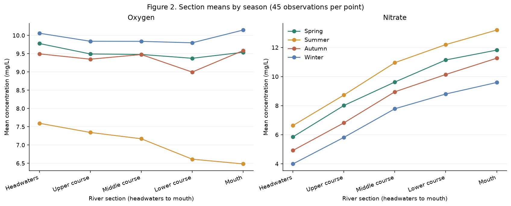

# River oxygen and nitrate analyses

Statistical analysis of 900 Saubach water-quality observations across five river sections and four seasons, prepared for the TU Dortmund M.Sc. Data Science summer-semester 2027 application task.

## Report

[Read the ten-page report](report/river_water_quality_report.pdf).

The report covers the data, mathematical methods, descriptive analysis, spring-autumn comparisons, river-section comparisons, diagnostics and limitations. The editable LaTeX source is in `overleaf/main.tex` and `overleaf/sections/`. [Download the Overleaf upload ZIP](report/saubach_overleaf.zip). The table of contents is on its own second page.

## Results

- Spring minus autumn nitrate: **+0.871 mg/L**, Holm-adjusted p = **1.22e-8**.
- Spring minus autumn oxygen: **+0.152 mg/L**, Holm-adjusted p = **0.324**.
- All ten section pairs differ for nitrate.
- Seven section pairs differ for oxygen when averaged over seasons: A1-A2, A1-A3, A1-A4, A1-A5, A2-A4, A3-A4, and A4-A5.
- Oxygen shows a section-by-season interaction, so its section averages do not describe a constant difference throughout the year.

Tests use a full factorial cell-means model, HC3 covariance, and one Holm correction over all 26 tests across both outcomes at alpha = 0.075. Intervals are pointwise 92.5% intervals. Conclusions assume independent observations; the CSV does not provide enough sampling metadata to verify independence. The findings do not establish causality or environmental safety.



## Reproduce the analysis

Python 3.12 is recommended. Windows / PowerShell:

```powershell
python -m venv .venv
.\.venv\Scripts\python.exe -m pip install -r requirements.txt
.\.venv\Scripts\python.exe src/download_data.py
.\.venv\Scripts\python.exe src/analyze.py
.\.venv\Scripts\python.exe src/inference.py
.\.venv\Scripts\python.exe src/build_report.py
.\.venv\Scripts\python.exe src/validate_outputs.py
```

On macOS or Linux, use `.venv/bin/python` in place of `.\.venv\Scripts\python.exe`. Local PDF generation requires Tectonic, latexmk, or pdfLaTeX. Alternatively, import `report/saubach_overleaf.zip` into Overleaf and compile `main.tex` with pdfLaTeX. Use `python src/build_report.py --source-only` to refresh the upload ZIP without a local TeX installation. The report uses 12-point Times-style fonts and 1.5 line spacing. The notebook `notebooks/01_exploration.ipynb` offers an interactive entry point; use a Jupyter-compatible editor with a kernel containing the requirements.

## Data and provenance

The original semicolon-separated CSV was downloaded on 17 November 2026 from [TU Dortmund University](https://statistik.tu-dortmund.de/storages/statistik/r/Downloads/Studium/Studiengaenge-Infos/Data_Science/waterquality.csv). The original application brief is retained in the repository. The data and brief are third-party university materials; no redistribution license is asserted for them.

Each section-season cell contains 45 measurements. Validation checks row count, columns, IDs, missingness, finite nonnegative concentrations, and the expected group sizes. All observations are retained. The downloader preserves an existing local copy. Source URL, file size, and SHA-256 are recorded in `data/raw/waterquality.metadata.json`; analysis records the input hash and software versions in `outputs/data_audit.json` and `outputs/inference_audit.json`.

## Repository structure

```text
data/raw/          Original CSV and provenance
notebooks/         Interactive exploration and results
outputs/figures/   Seasonal distributions, section profiles, model diagnostics
outputs/tables/    Descriptive statistics, all tests, intervals, sensitivity results
overleaf/          Editable LaTeX sections, tables and figures
report/            Ten-page PDF, text export and Overleaf ZIP
docs/              Requirements review
src/               Download, analysis, inference, and report-generation scripts
```

The implementation verifies the fitted cell means and HC3 covariance against direct cell-based calculations. Holm adjustment is also checked independently. HC2 covariance leaves all 26 adjusted test decisions unchanged. The report uses Saubach as the assumed name requested in the task. The bibliography and external citations were omitted at the author request. This means the university's book-reference and bibliography requirements are not met by this GitHub-only version; see `docs/requirements_review.md`.
